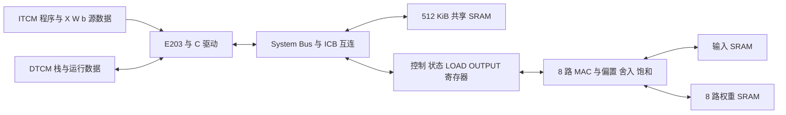

# E203 平台 FC1 加速器设计报告草稿

本设计面向芯片设计赛道本科组 FC1 任务，采用 E203 System Bus 接入方式，计算 `99×64 × 64×256 → 99×256` 的矩阵乘法、偏置和定点转换，并将全部结果写回共享 SRAM。硬件使用 8 路 MAC、16 位 Q12 输入和权重，支持 12 层独立参数。没有增加 DDR，也没有实现注意力、GELU 或完整 Transformer。

600 条内部开发样本的 7,200 个完整任务通过软件精度门槛；修正配置的真实 ASIC 分支 CPU 已通过 14 用例、354,816 个输出。当前综合候选为 `5946c54`，其硬件、固件、测试输入和平台准备与该 CPU 验收配置逐字节一致。严格 150 MHz 时序、该候选的完整门级功能和系统功耗仍待最终结果，因此本稿不是全部验收通过的提交报告。实时结果及哈希见[验收表](ACCEPTANCE_20261109.md)和[服务器证据](../../handoff/team/evidence/UNDERGRAD_D3_SERVER_20261109.json)。

## 系统结构

E203 执行 C 驱动，从 ITCM 读取程序和输入源，经实际总线把 X/W/b 搬入共享 SRAM，再通过内存映射寄存器向加速器供数、读取结果并写回。测试台只在复位释放前装入程序和源输入；参考结果仅供被动检查器比较，不进入 CPU 镜像或硬件计算路径。

输入矩阵的 6,336 个元素保存在两块 `4096×16` SRAM 中。权重按 8 列一组装入八块 `128×16` SRAM，每组复用输入矩阵并依次计算 99 行；一共 32 个列组。每路计算 64 项点积并加对应偏置，结果按“列组、行、lane”顺序输出。驱动把该顺序转换成行优先的完整输出矩阵。

ICB 适配器只允许一笔在途事务。副作用发生在命令握手时，应答在反压期间保持；未就绪 LOAD、空 OUTPUT 读取、错误地址、非完整控制写掩码或忙时重复启动均返回错误。CONTROL=2 清除任务状态和计数，新任务必须重新装载完整输入，因此无需物理清零 SRAM，也不能沿用前一任务的有效缓存状态。

| 地址或资源 | 用途 |
|---|---|
| `0x40000000` 起 4 KiB | 加速器 MMIO，包含控制、状态、shift、LOAD、OUTPUT 和计数 |
| `0x80000000` 起 256 KiB | ITCM；源输入位于 `0x80010000` |
| `0x90000000` 起 256 KiB | DTCM；软件栈位于其顶部 |
| `0xA0000000` 起 512 KiB | 团队补齐的共享 SRAM 映射 |
| `0xA000C000` | 99×256 个 int16 输出的起始位置 |
| `0xA001F000` | 状态、计数、周期和饱和数邮箱 |

完整寄存器位域和错误语义见 [README](README.md)，编码、字节序和流顺序见[数值格式](NUMERIC_FORMAT.md)。

## 数值表示和模型来源

模型固定为上游 [ARM keyword transformer](https://github.com/ARM-software/keyword-transformer) 提交 `237e4097afd4f6851e0b82f0a8d65c2dfe8eae30` 的 KWT-1 `best_weights`。没有训练、微调、蒸馏或调整模型结构。每层输入独立取自指定浮点模型的对应 Dense 层，前一 FC1 输出不作为下一层的替代输入。

| 数据 | 有符号位宽 | 小数位 |
|---|---:|---:|
| 输入和权重 | 16 | 12 |
| 偏置和 64 项累加 | 40 | 24 |
| 累加结果加偏置 | 41 | 24 |
| 输出 | 16 | `24−shift`，默认 shift=12 |

编码和输出转换采用最近舍入，恰好半值时远离零，最后饱和到 int16 范围。shift 支持 0–31。编码器接受任意有限且形状正确的 X/W/b，拒绝 NaN、Inf 和非法格式，并记录表示范围截限次数。解码器要求全部输出坐标恰好出现一次，以配置尺度还原实数并检查有限性。

开发评估从 Speech Commands V2 的 validation 划分按固定 SHA256 顺序选取 600 条样本：10 个目标词各 50 条、其他语音 99 条、静音 1 条。测试划分未用于尺度选择；本基线没有进行尺度拟合。全部样本、模型权重、提取代码和完整矩阵均有哈希记录，这 600 条数据明确属于内部开发集。

NRMSE 使用参考输出 RMS 归一化，分母下限为 `1e-8`。每层累计全部样本的误差平方和与参考能量后计算；每个任务还须独立满足 3% 门槛。7,200 个任务、182,476,800 个输出的最差层汇总为 **0.14941871%**，最差单任务为 **0.22915377%**，模型样本无编码截限和输出饱和。完整结果见 [D1 数值证据](../../handoff/team/evidence/UNDERGRAD_D1_20261109.json)。

## 存储和工艺适配

ASIC 路径保留 ITCM/DTCM 各 256 KiB、共享 SRAM 512 KiB 和加速器内部存储。两块 TCM 分别由 32 个大宏组成，共享 SRAM 使用 64 个大宏，加速器使用 2 个大宏和 8 个小宏；整机共 138 个宏、1,042 KiB 物理存储容量。

原平台保留在服务器原目录。安装器在新的独立运行目录应用补丁，并检查固定平台源码指纹。旧原生工艺实例按目标库的精确引脚和功能显式绑定；ASIC 路径不通过全局 FPGA 宏选择平台功能存储分支。目标条件为 SS、0.99 V、125°C，标准单元和 SRAM 库均锁定哈希。

厂商组件检查覆盖 TCM 的全部地址、写掩码和保持行为，共 98,682 次检查；启动映射核对 262,144 字节和 32 个 ITCM 宏。11 类实际标准单元及门控检查通过。这里的厂商功能模型用于功能验证，不能替代传播延迟和物理可靠性检查。

## 功能验证与恢复

验证从通用整数模型、组件与总线测试推进到实际 CPU 和综合网表。整数模型逐位复现位宽、偏置对齐、舍入和饱和；软件参考只用于独立比对。实际输出检查覆盖完整矩阵、坐标唯一性、流计数、饱和数和任务窗口。

| 验证层级 | 已完成的实测范围 | 配置边界 |
|---|---|---|
| 本地 RTL 和总线 | 25 任务、633,600 输出；包含全部层、筛选压力输入和连续恢复 | XSim pin_mock，不能作为厂商宏 CPU 证据 |
| 实际 E203 连续执行 | 两组 A/B/A，共 6 任务、152,064 输出；部分 17 次 LOAD 后中止、实际驱动超时及无复位恢复 | 平台功能 TCM 分支 |
| 修正配置 ASIC CPU | 12 层加 extremes、rounding，共 14 用例、354,816 输出 | 实际厂商存储与标准单元功能模型；完整任务启动选择和时钟模式检查通过 |
| 原 UART 与修正版对照 | 31,464 周期、213 次 APB 写、246 次读及 600 个 TX 边沿 | 验证无效 payload 默认值修正；不替代整机验证 |
| 历史门级首层 | 25,344 输出与完整任务窗口通过 | 旧映射、无 SDF；当前候选仍需完整门级重验 |

对 12 个模型层，修正配置 ASIC CPU 的输出饱和数均为 0。极值和舍入边界用例分别产生 6,336 和 4,554 个饱和输出，与独立参考逐项一致。通过证据分别绑定运行目录、源码提交、源输入摘要和实际日志，不能把相同数值摘要解释成同一次执行。

## 完整任务性能

任务计时从输入搬运之前的 BEGIN 邮箱写入成功应答开始，到最后一个输出写回成功应答结束。计时覆盖 CPU 从 ITCM 搬运源输入、驱动轮询、ICB 传输、加速器运算和完整写回；初始程序/输入源准备及任务状态失效位于该窗口之前。设备 done 只表示结果已被 MMIO 消费，正式任务完成还要求结果实际写回。

修正配置的 14 个 ASIC CPU 用例均测得 **3,890,080 周期**。以测试周期 6.666666 ns 换算，为 **25.93386407328 ms/task**、**38.5596221672 task/s**。CPU 自报包围区间为 3,890,176 周期，比被动窗口多 96 周期，二者不混用。严格时序通过之前，这些数字仅作为功能仿真的周期与频率换算结果。

每任务传入 23,488 个 16 位输入/参数字，写回 25,344 个 16 位输出。当前驱动使用逐半字复制和 CPU 供数，PR #6 的坐标递推及 32 位复制仍是独立待测候选；不能提前计入收益。[性能基线](BASELINE_PERFORMANCE_20261109.md)保留原窗口和换算依据。

## 时序 面积和功耗

严格 HF 时钟约束为 6.666666 ns，LF 为 66 ns。稳定任务模式固定 PLL 旁路、分频旁路和启动选择，实际任务监视器检查这些条件。四个 LF 计时器同步器只对首级 D 设置明确的跨域例外，后续级仍参与时序检查。三个 LF 控制输出使用其源时钟域的 1 ns 最大、0 ns 最小接口预算；这是接口假设，并非已取得外部接收器时序规格。

UART 无效发送 payload 缺省值造成的 24 个锁存器已在修正综合中消除，最差 hold 已转正；该轮剩余三条 LF 输出 setup 违规促成上述预算修正。最新完整端口清单修正版正在独立综合，最终 setup、hold、约束覆盖和最小裕量以其实际报告为准。稳定任务模式结论不包括上电过渡、全部调试模式或多角物理签核。详细依据见[时序复核](TIMING_REVIEW_20261109.md)。

面积统计逐一计入映射叶单元和全部 SRAM 宏。1,276 种标准单元及两种 SRAM 的 Liberty 面积已与 LEF 几何交叉核对，可以按 µm² 换算。整系统面积与官方计分面积分开列账；团队补齐的共享存储是否属于可豁免复用部分尚未确定。最终候选须重新按叶清单核算，不能直接采用历史配置面积。[面积复核](AREA_REVIEW_20261109.md)保留各宏数量、单位依据和条件情景。

功耗采用同一综合网表、同一任务窗口的完整 VCD，并核对 CPU、加速器、互连和各存储部件。历史波形已完成完整扫描，但旧功耗工具启动出现 PT-063，未作为通过结果。当前流程已修正子进程 LC 环境，补充实际单位、未知跃迁设置、外部边界网络和逐 SRAM 报告，仍须实际运行并审核。

当前功耗方法属于布局前、无 SDF 活动估算，未提取互连寄生和物理时钟树。未建模贡献不能记作零。能耗只在实际 W 单位、映射覆盖、未知值和各部件功耗均复核后，按 `E_J = P_W × duration_ns × 1e-9` 计算。[功耗复核](POWER_REVIEW_20261109.md)明确区分活动翻转覆盖与网表映射率。

## 来源 贡献和交付

| 来源 | 使用内容 | 团队工作 |
|---|---|---|
| 指定 KWT-1 模型与 Speech Commands V2 | 浮点模型、权重及开发样本来源 | 通用定点编码/解码、完整矩阵提取、独立整数对照与逐任务精度检查 |
| 官方 E203 平台 | CPU、总线和既有外设结构 | System Bus 集成、共享 SRAM 映射、ASIC 工艺适配和完整任务观测 |
| 团队既有架构二 | 8 路 MAC、定点转换与 SRAM 计算核心 | 架构三 ICB 适配、C 驱动、连续恢复及同配置验证流程 |
| 指定标准单元与 SRAM 厂商库 | 单元、存储模型和面积/功耗依据 | 显式绑定、指纹核验、实际容量/掩码检查和面积分组 |

以上来源分别保留原始归属。既有核心不作为本轮新发明，平台补丁与自主接口/驱动修改有明确源码记录；工具、厂商库和个人凭据不随工程分发。参赛创新说明只列有实际对照支持的改进，不把尚未测量的候选写成性能提升。

可复现工程、原始运行索引和证据入口见[交付索引](DELIVERY_INDEX_20261109.md)。交付前仍需完成当前候选的严格时序、完整门级与同窗口功耗，统一最终面积/性能/能耗配置，并核对芯片设计赛道的实际提交模板、字段和视频要求。公开[芯片设计赛道通知](https://www.xupt.edu.cn/info/2104/87092.htm)只说明 11 月中旬截止，精确日期不能由其他赛道替代。
