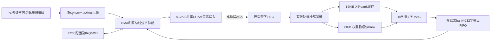

# 架构三系统设计与验证报告：32位ICB无损搬运与16×4 MAC

版本：2026-11-11 13:00准备稿。新候选已经完成真实ASIC/E203 14例、354816输出、竞争与恢复验证，新综合也已生成；同网表14例门级及12个完整活动窗口已全部通过，十二层功耗已收齐。12层平均34616周期，按150MHz折算4333.256 task/s。本文说明实际实现与已测范围，本候选最终1200真实ASIC任务已全部通过30412800输出，最终同配置汇总报告正在生成。实时状态见[验收表](ACCEPTANCE_ICB32_20261111.md)，不以本文的阶段性进度替代最终回执。

## 1. 任务、要求与设计取舍

本科任务为一次`99×64 × 64×256 + bias`，每任务1622016 MAC、25344个16位结果。保持指定模型、Q12数值规则和原32位ICB平台接口；不训练、微调、蒸馏、改模型或改用INT8。

用户提供的赛题答复允许离线量化、重排与打包，要求加载环境自行实现、实际硬件传输不可省略，并从开始加载计到结果写回。答复原文和来源说明保存在[加载答疑](QA_DMA_LOADING_20261109.md)。答复没有逐项明确确认“压缩数据落库后按写ACK转发”；本设计将其作为遵循实际落库要求的工程解释，不能在参赛材料中表述为组委会已逐项批准。

本项目采用新增面积≤2.00mm²、SS/0.99V/125°C、150MHz（工具周期6.666666ns）。5000 task/s是团队优化目标；取得功能正确、可复现、面积和时序合格的版本优先。官方评分依据见赛题第12/14、13/14页，当前赛题材料索引见[交付索引](DELIVERY_INDEX_20261109.md)。

## 2. 整体结构与真实加载

PC/TB仅预读文件。ITCM包含程序和16B任务配置，不包含本任务的X、权重或偏置。源窗口从`0xB0000000`开始；共享SRAM为`0xA0000000..0xA007FFFF`，默认结果起址`0xA000C000`，控制寄存器基址`0x40000000`。

每个输入字依次经过源读、共享写、成功写响应，再交给解码器。共享存储中保留可按格式恢复的完整编码数据；没有源数据到MAC的提前旁路。写错误不发布该字，已接受事务仍须排空。输出保持99×256行主序，不压缩。

总线保留32位宽、全局单笔在途；旧响应完成与下一请求接受可以发生在同一拍。旧owner与新owner分别保存，响应归属不能被同拍新请求覆盖。源为同步响应模型，遵守最早下一拍应答；共享控制器不缩短厂商同步宏的存储时序。

## 3. 数据格式与数值一致性

数值核心复用既有`dot64`和重定量化逻辑：16位输入/权重、40位偏置与累加路径、41位加偏置结果，shift、舍入与饱和规则保持不变。具体数值定义、模型来源和误差公式见[数值说明](NUMERIC_FORMAT.md)。

布局先X行主序，再16个tile；每tile权重按k→lane排列，偏置沿用三半字表示。无损编码只改变传输表示，不改变原整数。64元素块按最小有符号位宽1..16打包；32B总头和每块4B头均明确版本、长度和保留位，小端、4B对齐。无压缩收益时回退到32B头加46976B原始数据，合法流最大47008B。

解码器检查头部、布局、长度、位宽、元素数、填充、截断和多余数据，恢复原23488个半字。软件检查独立使用原始矩阵坐标，既核对无损恢复，也逐坐标比较RTL结果与饱和标记。格式规范和可复现脚本见[codec v2](ICB32_CODEC_V2.md)、`scripts/icb32_codec.py`和`scripts/icb32_data.py`。

内部600开发样本的既有软件数值结果仍属内部评估。新传输编码逐位保持原Q12整数，但最终候选自己的100×12硬件回归已于本轮独立完成；这些结果不替代官方随机600样本精度验收。

## 4. 计算、缓存与重叠

同一计算引擎支持R=1或4。正式R4为16列×4行，共64个复用MAC，权重同时广播到4行。99行分25组，末组仅3行有效，禁止生成第100行结果。纯MAC调度的理想更新周期为25600，完整任务仍包含首批加载、控制和写回。

| 存储或队列 | 实际结构 | 作用 |
|---|---|---|
| X缓存 | 64个128×16宏，共16KiB，按row%4和k%4分bank/分段 | 每任务完整加载一次，向列lane广播 |
| 权重缓存 | 16 lane×2 bank，共32个128×16宏、8KiB | 计算bank与预取bank物理独立 |
| 源FIFO/提交FIFO | 各16个32位字 | 分离源响应与成功共享写后消费 |
| 命令队列 | 8项 | 保存请求及其归属信息 |
| 结果bank | 两组，每组最多64个16位结果及饱和标志 | 解耦整组计算完成与输出打包 |
| 输出FIFO | 32个32位字，另含地址/控制 | 满时反压，等待实际写响应 |

权重与偏置全部装齐后才发布bank有效；当前bank计算期间允许加载下一tile，同任务内重叠，不加载下一任务。X缓存没有为4行简单复制4份。全部新增缓存、MAC、DMA、解码器、仲裁、FIFO和控制均计入新增面积。

## 5. E203控制、错误与完成

保留原控制地址和调试LOAD/OUTPUT入口，增加能力、版本和任务级DMA字段。R4设备ID为`0x4B574604`，DMA布局ID为`0x00100002`；旧DMA布局在新正式DMA路径明确拒绝，避免静默误读。完整寄存器表见[ABI](ICB32_ABI.md)。

任务启动时锁存配置，检查固定尺寸、长度、对齐、溢出和地址重叠。成功共享入库的编码字节、解码半字和结果数量分别统计，不能混用。CPU有请求时，仲裁最多允许8次DMA接受机会后服务CPU；真实竞争诊断实测最大为1次。

正常完成必须同时满足：输入全部成功入库、解码完成、核心结束、全部输出写ACK成功，以及缓冲和事务排空。最后一次MAC更新或结果进入FIFO均不足以触发DONE。取消/首错停止新调度，已经对外发出的VALID保持稳定直到握手，排空已接受事务后失效任务状态。

正式固件使用实际PLIC/CLINT、中断处理和WFI等待。CPU竞争与恢复使用独立polling诊断固件，不用于性能或功耗样本。真实恢复验证包括5次store-access-fault恢复、初载取消、4096周期超时排空，以及无复位A/B/A连续任务。

## 6. 性能口径与贡献拆分

开始事件为本任务首个源读VALID发出，包含首次ready等待；结束事件为最终输出成功写响应，随后核对排空和真实CPU完成。每任务冷缓存，PC读文件/一次性转换可排除，进入硬件后的传输、等待、调度、解码、计算和写回全部计时。重叠阶段跨度只用于分析，不相加充当总时间。

原完整读回路径每任务47904个32位事务。新路径编码长度为B时，事务为`2×(B/4)+12672`，分别来自源读、共享输入写和输出写。12层现有编码平均31223.333个事务，即使每周期接受一个事务也超过5000 task/s对应的30000周期。因此本候选不以更换计时口径来追求目标。

在这个理想单周期事务模型下，当前12层平均编码量的吞吐上界约4804.099 task/s；实际4333.256约为该上界的90.199%。这只是由流量与实测总周期算出的事务占用比例，不代表源/SRAM可以无等待，也不是功耗效率。仅使事务下界降至30000周期，就要求编码长度≤34656B；当前12层平均37102.667B仍高于此值，且首批装载和流水线首尾还要计时。单独增加MAC数量不能消除这一下界。

| 对照 | 平均完整周期 | 结论及证据范围 |
|---|---:|---|
| 原fcd 16路DMA完整读回 | 225770 | 真实ASIC/E203历史基线，664.393 task/s |
| R1，同新搬运/编码 | 116280 | 本地14例与R4全部输出一致；服务器PPA待做 |
| R4，新通路raw模式 | 38052 | 固定R4与编码版本12层304128输出一致；本地无CPU/PPA |
| R4，新通路无损编码 | 34616 | 真实ASIC/E203 14例通过，4333.256 task/s |

R1→R4局部加速3.359140倍；固定R4的raw→编码使周期减少9.0297%、事务减少13.6905%。原fcd→R4总体周期比6.522128倍，包含搬运、编码与并行计算的共同改变，不能全部归因于MAC数量。局部对照见[行并行比较](ICB32_LOCAL_COMPARISON_20261111.md)和[编码比较](ICB32_LOCAL_CODEC_COMPARISON_20261111.md)。

性能数字均为仿真周期在150MHz下折算，不是实芯片吞吐测量。新被动观察器还将导出实际MAC利用率、X/W宏端口次数、三段应答延迟、ready等待和输出反压；964干净目录真实ASIC/E203 14例已完成：每例MAC更新1622016、X读101376/写6336、W读409600/写16384；首层MAC利用率73.166%、事务/总周期90.609%。首层三段接受至响应平均均1周期，不能等同请求发起间隔；[计数证据](../../handoff/team/evidence/ICB32_METRICS14_20261111.json)。访问计数不能代替功耗。

## 7. 面积、时序和功耗

综合统一使用SS、0.99V、125°C、6.666666ns。新网表含128个大SRAM宏（64共享、64 TCM）与96个加速器小宏；共224宏，无锁存器、无组合环、无约束违例。源码、库和综合网表身份见[综合摘要](../../handoff/team/evidence/ICB32_SYNTH_20261111.json)。

| 指标 | 当前实际结果 | 解释 |
|---|---:|---|
| 已识别新增模块面积 | 0.7658783064mm² | 包含新增控制和内部SRAM |
| 保守计入预算上界 | 0.9265616712mm² | 另将全部SoC标准单元计入，仅排除128个复用大宏；小于团队2.00mm²限制 |
| 整机综合叶单元面积 | 4.4487781712mm² | 包含复用TCM/共享宏，不能与新增面积限制直接比较 |
| setup裕量 | +0.0000715256ns | 声明的稳定任务模式综合时序已接受，范围见独立审阅 |
| hold裕量 | +0.000253469ns | 同上；无SDF功能门级不代表延迟签核 |
| 新ICB32平均功耗/能耗 | 12层加权平均71.8126319mW、平均16.5724388µJ/task | 完整12层布局前估算；[实际进度](../../handoff/team/evidence/ICB32_POWER_PROGRESS_20261111.json)，系统功耗未知活动影响审核仍未完成 |

功耗采用同一综合网表、库、工艺条件和12层完整任务活动，覆盖E203、互连、新增逻辑、共享SRAM与TCM。明确动态、泄漏、总功耗及各模块归属，SRAM细分不重复加到整机总数。缺失模型或未知活动不按零计算；原始数值存在不自动等于系统功耗验收。当前属于布局前估算，没有物理签核或芯片实测。

功耗报告使用每任务实际持续时间求能量，整轮平均功耗为`ΣE/Σt`、平均能耗为`ΣE/12`，不把不同任务时间的功耗简单平均。节能结论由实际同配置结果支持，不能仅凭WFI、门控信号存在或周期减少推断。

## 8. 验证证据与最终缺口

| 项目 | 截至本文版本的结果 |
|---|---|
| 数值、codec、坐标及局部接口 | 本地14例nominal/jitter、raw/极值/舍入、坏流、错误响应、取消及末组等通过；不替代真实CPU |
| 真实ASIC/E203 | e65包14例，354816输出，IRQ/WFI通过；[证据](../../handoff/team/evidence/ICB32_ASIC14_20261111.json) |
| 真实CPU竞争/恢复 | 497包2竞争例50688输出、10恢复阶段76032输出；[证据](../../handoff/team/evidence/ICB32_CPU_DIAGNOSTICS_20261111.json) |
| 同网表功能门级 | 497原队列14例354816输出全部通过，12层周期与ASIC一致；无SDF |
| 完整活动和功耗 | 12个完整活动窗口已收齐；十二层功耗及活动映射核对全部完成，系统功耗未知影响审核保留 |
| 干净目录真实计数复现 | 964包636输入及生产身份核验通过；真实ASIC14/354816输出及被动计数复现通过 |
| 最终100×12任务 | 新候选自己的1200任务/30412800输出全部通过、零失败、一次编译；批量平均34618.7433周期，独立于12层PPA均值；不能继承原fcd的PASS |
| 官方精度和物理结果 | 官方600样本精度、布局后功耗/时序及物理签核未验证 |

执行器和报告工具保持失败、停止和未验证项。已完成且身份一致的受测工作不重复；新的测试观察器或文档提交不更换原受测硬件身份。最终结果以同配置JSON、CSV、中文报告及逐例回执哈希为准。

## 9. 复现与提交材料

独立运行包包含源码、E203固件、14例逻辑输入、布局和manifest；厂商库与许可证保持服务器原位置。`package_icb32.py`从干净提交导出并重新构建固件，FileZilla上传新目录后核验ZIP和逐文件哈希。运行顺序及命令见[运行手册](ICB32_RUNBOOK.md)。

当前主ASIC/综合为e65包，门级/活动为497包；964包是相同硬件及生产固件的计数工具更新，生产manifest与ELF、所有启动映像已独立比对。诊断序列ELF仅非装载调试/符号节不同，不能宣称整个包或所有ELF逐字节相同。证据见[包身份](../../handoff/team/evidence/ICB32_METRICS_PACKAGE_20261111.json)。

最终交付包含RTL/驱动/验证工程、数值与转换说明、实际网表和SDC、面积与时序、同窗活动/功耗、1200任务、来源与失败记录，以及干净目录复现命令。大VCD与EDA运行产物留服务器并提供路径/哈希，小型源码与证据同步团队私人仓库个人分支。正式提交清单及实际入口确认后按要求装包，不将本准备稿标为最终合格包。

## 10. 创新和来源界定

本轮贡献集中于原32位框架下的任务级DMA、成功写ACK后发布的数据流、可复现无损tile编码、同拍事务交接，以及权重广播的16×4计算和预取/写回重叠。每项代价由新增逻辑、缓存、时序和实测能耗说明。

指定模型、原E203平台、厂商标准单元/SRAM、既有Q12参考模型和`dot64`属于来源与复用基础，遵循原工程许可证，不宣称为本轮原创。具体作者归属以仓库提交、团队实际贡献与最终来源表核对，不凭工具生成记录补写人名。答辩内容见[设计与创新说明](ICB32_INNOVATION_20261111.md)。

| 来源层次 | 可核对的工程入口 | 本轮归属说明 |
|---|---|---|
| 指定KWT1模型及预训练参数 | [数值说明](NUMERIC_FORMAT.md)中的上游来源、checkpoint与捕获manifest | 指定模型复用；本轮无训练和结构修改，不将内部样本结果称官方精度成绩 |
| 官方E203固定平台 | `install_icb32.py`及其依赖安装器、运行包的原平台指纹 | 原平台在服务器独立保留；只在受测副本集成新模块，保留原来源和许可说明 |
| 既有定点MAC与重定量化 | `workspaces/arch02/rtl/dot64.sv`、`requantize.sv` | 团队既有数值核心复用；本轮新增的是行并行调度和供数，不是重新发明MAC数值算法 |
| ICB32搬运、解码和R1/R4引擎 | `arch03_icb32_accel.sv`、`arch03_linear16x4.sv`、`icb32_codec.py`及相关模块 | 新路线实现于提交`6a6f6ea`；实际验收仍绑定e65/497/964的逐文件身份，不能用后续文档提交号代替受测配置 |
| 标准单元、SRAM模型与EDA工具 | 新综合与功耗运行的库清单、工具路径和哈希 | 外部依赖，不作为团队源码发布；不打包厂商库、许可证或凭据 |

提交材料保留上述来源分层和实际文件哈希；个人作者及队员分工由团队依据真实贡献填写。文档与测试工具的更新另列，不能据此转移旧硬件的验收结论。
