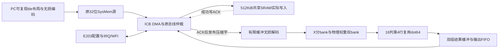

# ICB32候选的设计说明与答辩要点

截至2026-11-11，R4真实ASIC/E20314例已通过354,816个输出，12层平均34,616周期；按150MHz折算4,333.256 task/s。新综合已完成，setup/hold为正，新增面积保守上界0.926562mm²；真实CPU竞争和恢复也已通过。同网表门级/活动正在运行，完整时序范围和功耗仍待审定。最终以[验收表](ACCEPTANCE_ICB32_20261111.md)和同一冻结配置的完整报告为准。

## 解决的问题

任务仍为`99×64 × 64×256 + bias`，每任务1,622,016 MAC和25,344个输出。原32位接口的搬运量限制了单纯增加MAC的收益。本轮保留原总线宽度和Q12数值规则，同时减少总线事务并增加计算并行度。

源数据必须实际写入共享SRAM并成功应答后才能解码消费；错误写响应不发布。共享中保留的是明确说明、可重建的编码数据，输出仍是原16位行主序。此方案是团队依据“遵循平台接口、实际落库、不省略传输”的答疑作出的工程解释，不能表述成赛题方逐项确认了ACK转发或压缩存储。

## 复用与新增内容

| 项目 | 本轮实现 | 收益与代价 |
|---|---|---|
| 无损输入编码 | PC按64元素块选最小有符号位宽，原偏置编码保留；小端打包、总头/块头明确，压缩无收益时raw回退 | 原Q12逐位可逆，无训练/位宽降精度；新增解码器和格式检查 |
| 共享写ACK后转发 | 保留真实共享写入与响应；已提交字才进入解码器，去掉重复共享读回 | 减少32位事务；需要提交缓冲、错误/取消排空和明确计数 |
| 同拍退旧/接新 | 原全局单笔在途接口保留，旧响应归属与新命令归属分开 | 减少人为协议空拍；源与同步SRAM时序仍实际遵守 |
| 16×4计算 | 复用原dot64、40位累加/41位加偏置、shift/舍入/饱和；权重广播4行，X按行分bank；第99行尾组屏蔽无效行 | 增加MAC并行度；资源、150MHz及能耗必须由新网表衡量 |
| 同任务重叠 | 权重两个物理bank、完整发布有效，双组结果与FIFO反压；E203 IRQ/WFI | 预取/计算/写回重叠；不提前装下一任务，不把重叠跨度相加当总周期 |

E203、厂商库/模型、上游模型及原定点核是复用基础，按原工程来源与许可说明；本轮贡献是数据通路、控制、编码和集成实现，不宣称发明新的乘法算法或模型结构。

## 当前可引用的对照

R1和R4本地使用完全相同编码输入、流量、测试台和RTL源码，仅行并行参数不同。14例全部输出按坐标重新比较一致；12层平均周期116,280与34,616，局部加速**3.359140×**。见[逐层对照](ICB32_LOCAL_COMPARISON_20261111.md)。这项局部对照的R1尚未真实E203验收，不能混称两套服务器PPA。

R4在真实ASIC/E203中复现了同样的34,616平均周期，真实IRQ/WFI通过。原fcd 16路DMA的225,770周期属于另一套完整搬运架构；完整任务周期之比为6.522128×，两者的总体变化同时包含搬运、编码和MAC调度，不能全部归因于MAC数量增加。新版本按150MHz折算7,028.611 MMAC/s，与4,333.256 task/s使用相同完整任务窗口；这些是仿真周期折算值，不是芯片实测。新版本能耗及同条件完整PPA仍须使用自己的报告，不能从周期比推出功耗比。

另一项[编码局部对照](ICB32_LOCAL_CODEC_COMPARISON_20261111.md)固定R4、同数据与同通路，仅选择raw或无损编码；12层304,128个输出逐坐标一致，全部硬件和测试台哈希相同。平均周期38,052→34,616，减少9.0297%；总线事务36,176→31,223.333，减少13.6905%。该项同样是本地无CPU/PPA对照，说明压缩贡献的边界，不据此推算能耗。

本轮完整计时从本任务首源请求VALID（包含ready等待）至最后结果写响应，随后检查排空。PC文件预读和一次性编码不计时，编码数据进入硬件的实际传输计时。每任务冷启动，输出不压缩。DMA、decoder、仲裁、FIFO、内部缓存及共享控制器新增逻辑全部计入面积预算；规定的512KiB共享SRAM宏与复用平台模块单独报告，系统功耗仍覆盖这些复用模块。

5000 task/s目前未达到。当前编码在32位单笔在途通路上仍存在事务下界，不能靠缩短统计窗口或跨任务预载隐藏开销。当前工作重点是补齐150MHz、面积、同网表门级、功耗与最终1200任务，取得可复现的完整结果；能耗比较等待各自同配置PPA。

最终展示应附同配置JSON/CSV、实际网表/固件/数据/库哈希、失败和未验证项。内部100样本回归与600开发样本数值结果不标为官方600样本精度验收；布局前功耗也不标为实板测量或物理签核。
