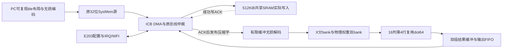

# ICB32候选的设计说明与答辩要点

截至2026-11-11，R4真实ASIC/E20314例已通过354,816个输出，12层平均34,616周期；按150MHz折算4,333.256 task/s。新综合已完成，setup/hold为正，新增面积保守上界0.926562mm²；真实CPU竞争和恢复也已通过。同网表门级14/活动12已通过；12层布局前平均71.8126mW、16.5724µJ/task已获得，完整时序范围和未知活动影响仍待审定。最终以[验收表](ACCEPTANCE_ICB32_20261111.md)和同一冻结配置的完整报告为准。

## 解决的问题

任务仍为`99×64 × 64×256 + bias`，每任务1,622,016 MAC和25,344个输出。原32位接口的搬运量限制了单纯增加MAC的收益。本轮保留原总线宽度和Q12数值规则，同时减少总线事务并增加计算并行度。

源数据必须实际写入共享SRAM并成功应答后才能解码消费；错误写响应不发布。共享中保留的是明确说明、可重建的编码数据，输出仍是原16位行主序。此方案是团队依据“遵循平台接口、实际落库、不省略传输”的答疑作出的工程解释，不能表述成赛题方逐项确认了ACK转发或压缩存储。

## 复用与新增内容

| 项目 | 本轮实现 | 收益与代价 |
|---|---|---|
| 无损输入编码 | PC按64元素块选最小有符号位宽，原偏置编码保留；小端打包、总头/块头明确，压缩无收益时raw回退 | 原Q12逐位可逆，无训练/位宽降精度；新增解码器和格式检查 |
| 共享写ACK后转发 | 保留真实共享写入与响应；已提交字才进入解码器，去掉重复共享读回 | 减少32位事务；需要提交缓冲、错误/取消排空和明确计数 |
| 同拍退旧/接新 | 原全局单笔在途接口保留，旧响应归属与新命令归属分开 | 减少人为协议空拍；源与同步SRAM时序仍实际遵守 |
| 16×4计算 | 复用原dot64、40位累加/41位加偏置、shift/舍入/饱和；权重广播4行，X按行分bank；第99行尾组屏蔽无效行 | 增加MAC并行度；资源、150MHz及能耗必须由新网表衡量 |
| 同任务重叠 | 权重两个物理bank、完整发布有效，双组结果与FIFO反压；E203 IRQ/WFI | 预取/计算/写回重叠；不提前装下一任务，不把重叠跨度相加当总周期 |

E203、厂商库/模型、上游模型及原定点核是复用基础，按原工程来源与许可说明；本轮贡献是数据通路、控制、编码和集成实现，不宣称发明新的乘法算法或模型结构。

## 当前可引用的对照

R1和R4本地使用完全相同编码输入、流量、测试台和RTL源码，仅行并行参数不同。14例全部输出按坐标重新比较一致；12层平均周期116,280与34,616，局部加速**3.359140×**。见[逐层对照](ICB32_LOCAL_COMPARISON_20261111.md)。这项局部对照的R1尚未真实E203验收，不能混称两套服务器PPA。

R4在真实ASIC/E203中复现了同样的34,616平均周期，真实IRQ/WFI通过。原fcd 16路DMA的225,770周期属于另一套完整搬运架构；完整任务周期之比为6.522128×，两者的总体变化同时包含搬运、编码和MAC调度，不能全部归因于MAC数量增加。新版本按150MHz折算7,028.611 MMAC/s，与4,333.256 task/s使用相同完整任务窗口；这些是仿真周期折算值，不是芯片实测。新版本能耗及同条件完整PPA仍须使用自己的报告，不能从周期比推出功耗比。

另一项[编码局部对照](ICB32_LOCAL_CODEC_COMPARISON_20261111.md)固定R4、同数据与同通路，仅选择raw或无损编码；12层304,128个输出逐坐标一致，全部硬件和测试台哈希相同。平均周期38,052→34,616，减少9.0297%；总线事务36,176→31,223.333，减少13.6905%。该项同样是本地无CPU/PPA对照，说明压缩贡献的边界，不据此推算能耗。

本轮完整计时从本任务首源请求VALID（包含ready等待）至最后结果写响应，随后检查排空。PC文件预读和一次性编码不计时，编码数据进入硬件的实际传输计时。每任务冷启动，输出不压缩。DMA、decoder、仲裁、FIFO、内部缓存及共享控制器新增逻辑全部计入面积预算；规定的512KiB共享SRAM宏与复用平台模块单独报告，系统功耗仍覆盖这些复用模块。

5000 task/s目前未达到。当前编码在32位单笔在途通路上仍存在事务下界，不能靠缩短统计窗口或跨任务预载隐藏开销。当前工作重点是补齐时序/面积范围说明、功耗与最终1200任务，取得可复现的完整结果；能耗比较等待各自同配置PPA。

最终展示应附同配置JSON/CSV、实际网表/固件/数据/库哈希、失败和未验证项。内部100样本回归与600开发样本数值结果不标为官方600样本精度验收；布局前功耗也不标为实板测量或物理签核。

## 三分钟说明顺序

1. **任务和限制，约30秒。** 说明一次任务完成99×64乘64×256并加偏置、写回25344个结果；保留E203与原32位ICB。计时从本任务首个源请求发出到最后结果写响应，包含实际加载和等待。模型与Q12数值规则不变。
2. **瓶颈和改进，约60秒。** 用上面的通路图说明：每字实际写共享SRAM成功后才发布给解码器，消除重复读回；PC无损编码减少总线字数；16列×4行通过权重广播增加计算并行。展示物理双bank、结果缓冲及反压如何在同一任务内重叠，不预装下一任务。
3. **证据和代价，约60秒。** 展示真实ASIC14、CPU竞争/恢复和同网表14例门级回执；最终1200完成后再列对应证据。引用34616周期、4333.256task/s及0.926562mm²保守面积上界，并说明150MHz为周期折算、综合任务模式时序裕量很小。功耗与能耗使用最终同配置12层报告，当前阶段值不放进“最终成绩”表。
4. **取舍与边界，约30秒。** 展示固定R4的raw/编码对照和同通路R1/R4局部对照，分别说明贡献；承认5000目标未达，说明总线事务下界。保留功能合格退路，明确官方精度和布局后结果的未验范围。

## 证据展示顺序

先显示最终配置的源码、固件、布局、数据、库及网表身份，再展示逐任务结果与完整计时边界。功能部分用原始输出与独立参考逐坐标比较、错误/取消恢复回执；性能部分展示事务数量和完整周期；最后展示面积及同窗口功耗/能耗。

现场若需要重新运行，用[运行手册](ICB32_RUNBOOK.md)在新目录复现同一固定输入，先检查共享锁。演示操作不覆盖已有原始证据，也不把读取历史报告说成现场硬件运行。当前串行验证队列运行期间不另开演示作业。

## 常见追问与回答边界

| 追问 | 建议回答 |
|---|---|
| 为什么没有达到5000task/s？ | 当前12层平均编码37102.667B，需要约31223.333个总线事务；即使理想每周期一个事务，也超过目标30000周期。实测34616周期保留全部传输和等待；增加MAC不能消除这一下界。 |
| 压缩会降低精度吗？ | 仅对既有Q12整数作无损传输编码，原偏置/shift/舍入/饱和不变。按原始矩阵坐标独立核对恢复数据，再逐输出比较RTL；没有INT8、训练或模型修改。 |
| 是否真的写入共享SRAM？ | 写请求、掩码和成功写响应均实际经过共享控制器；成功ACK后才允许消费该字，写错不发布。共享中保存可重建的编码流。ACK转发/压缩落库是团队对答疑的工程解释，不称赛题方已逐项许可。 |
| 加速来自MAC增加还是压缩？ | 同通路R1→R4的本地局部加速为3.359140倍；固定R4时raw→编码减少9.0297%周期。总体6.522128倍还包含搬运架构变化，不能把它全部归因于某一项。局部对照没有完整服务器PPA，不扩大其证据范围。 |
| 新增面积有没有漏掉总线逻辑？ | 保守上界计入全部SoC标准单元与全部加速器内部SRAM，只排除明确复用的128个大存储宏，覆盖DMA、解码、仲裁、FIFO及胶合逻辑；复用面积单列，官方最终归属不擅自确认。 |
| 功耗是实板测量吗？ | 是同一综合网表和完整任务活动的布局前估算，整机包含E203、互连和相关SRAM。公布工具设置、活动覆盖、未知值与模型限制；不宣称布局后或实芯片功耗。 |

最终答辩前将本节的批量与功耗状态替换为实际完成的报告引用；未完成项目继续保留未验证标记，不使用其他配置的最好结果拼接。
