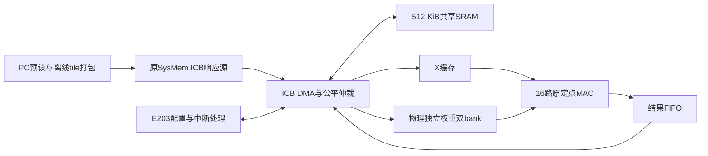

# 架构三创新对照与答辩草稿

状态：2026-11-10准备稿，尚未完成最终验收或正式提交。本文以当前fcd445f生产RTL为候选，所有“通过”都有具体范围。最终应由同一冻结配置的统一报告替换中间数据，不拼接不同版本的最佳指标。

## 设计解决了什么问题

任务是完整执行一次99×64乘64×256并加偏置，输出99×256个定点结果。保留E203、原系统ICB互连和512KiB共享SRAM；PC只提前读文件及离线转换，任务进入硬件后的源读取、共享入库、缓存装载、计算和最终写响应全部计时。

原8路方案由E203逐半字装载加速器、轮询并读回结果，再写入共享SRAM。新版把这段任务级数据调度交给ICB DMA，E203负责检查配置、启动、异常恢复和中断等待；MAC继续采用团队原有Q12数值规则。性能改善来自搬运与调度方式改变以及16路计算，不能全部归因于lane数翻倍。

共享SRAM到缓存的数据同样经过ICB DMA，绝非存储器私有端口。源读取后的输入必须先取得共享写成功响应，再由共享读取到缓存；下一任务不提前加载。

## 三项自主改进及证据

| 改进 | 实现与作用 | 已有证据及限制 |
|---|---|---|
| 任务级ICB DMA | 原总线增加主设备、CPU/DMA公平仲裁、请求归属和单笔在途响应跟踪；输出坐标与地址由硬件产生，DONE等待最后写响应和排空 | 真实E203 ASIC14例、程序-only物理ITCM启动、原SysMem源接口及全部写回通过；真实CPU竞争程序已准备但尚待执行，不能由WFI时CPU不争用推断竞争实测通过 |
| 可复现tile布局 | X行主序；16tile，每tile权重按k→lane连续排列，偏置保留原三半字编码；32位小端打包两个16位元素 | 独立按原矩阵坐标逐元素核对，布局/源数据/软件参考和RTL输出具有哈希绑定；离线转换可排除，转换结果进入硬件的搬运仍计时 |
| 计算与预取／写回重叠 | 16lane×2bank共32个独立小SRAM宏；X两大宏；结果FIFO对下游反压；完整bank到齐才有效，禁止覆盖未提交结果 | 本地定向bank/FIFO/反压测试及实际ASIC14例通过；正在进行同网表全14例门级和12份完整活动，尚不能宣称最终PPA闭环 |

原定点点积、舍入和饱和核心以及团队既有8路工程是复用基础。E203、工艺库、SRAM模型、工具与上游模型分别标明来源；不把这些内容列为本轮自主发明。不训练、微调、蒸馏或扩展模型结构。

## 已取得的同源RTL对照

两版均使用同一组12层逻辑输入、同一同步32位源模型（接受后下一拍响应）、同一共享SRAM时序，以及完整首源VALID至最后输出写响应的事件边界。布局随架构声明，源服务和有效数据量一致。

| 项目 | 原8路MMIO对照 | 新16路DMA候选 |
|---|---:|---:|
| 实际运行 | c5e0bbf / mmio8_source02 | fcd445f / dma16_fix_full01 |
| ASIC RTL／E203任务 | 14（12层＋2边界）通过 | 14（12层＋2边界）通过 |
| 逐项输出核对 | 354816 | 354816 |
| 12层每任务完整窗口周期 | 3843121 | 225770 |
| 150MHz标称频率换算task/s | 39.030777 | 664.392966 |
| 同频换算MMAC/s | 63.308545 | 1077.656022 |
| 四段有效搬运字节／任务 | 191616 | 191616 |
| 四段数据区ICB成功事务／任务 | 72320 | 47904 |
| 新窗口同条件PPA | 尚待新综合／门级／功耗 | 新综合已收回，门级／功耗审核未完成 |

上述周期之比为17.022284。事务数仅含源读、共享入库、共享输入读和输出写，不含MMIO轮询、配置、指令或邮箱事务，不能当整机总事务数。MMIO8首VALID可能在时钟沿后1ns发出，保留真实事件时间并保守向上取整周期；功耗仍按实际事件窗口，不能把取整误差混入能量。

500task/s是团队目标。225770周期在标称150MHz下超过该目标，但当前不是芯片实测频率或最终严格PPA通过，更不是获奖保证。正式效率排名取决于本组合格作品对照，不能从本队目标推出得分或名次。

## 面积、时序和能耗怎么解释

新综合网表使用SS、0.99V、125°C，HF周期6.666666ns。setup最差+0.0000290871ns，hold+0.00136402ns；裕量很小，仍需逐对象解释高扇出、时钟与禁用弧，不能只展示正数而省略限制。当前门级功能使用无SDF功能模型，功能结果与时序报告分别证明各自范围。

独立逐叶复算把全部SoC标准单元294096.516000µm²和加速器内部34个SRAM宏140700.265612µm²都计入，保守上界0.434796781612mm²，低于团队2.00mm²限额。仅单列复用的共享64大宏及ITCM／DTCM各32大宏，整机面积约3.957013mm²。这个上界不会因新增glue内联到平台层级而漏计；精确具名新增模块面积不能冒充全部新增面积。赛题按逻辑综合结果核验面积，不要求物理边长／布局布线验收。

系统功耗应包含E203、TCM、加速器、DMA／仲裁／路由、共享SRAM和相关平台。12个任务分别采集全窗口活动、核对模型和单位后，逐任务计算E=P×t，总平均功耗为总能量除总时长。现在没有已审核的DMA16系统功耗或J/task，不填写推测值；WFI、片选和使能是实现措施，尚不是实测节能结论。完整模型、未知活动、映射覆盖及布局前互连假设都要随报告披露。

## 演示和复现时的顺序

1. 展示冻结manifest、源码／固件／布局／数据／库哈希，说明上游、团队既有和本轮贡献；干净目录复现。
2. 展示首源VALID、共享写ACK后读回、最终输出ACK、FIFO与未决事务排空的统一时间线；CPU指令镜像不含任务输入。
3. 展示12层及舍入／饱和两例的实际E203输出核对，再展示无复位A/B/A、取消和超时恢复回执。局部替身与真实CPU结果分开。
4. 用同源原8路对照解释周期差异；同时提供新增面积、系统功耗和J/task，未完成项不填零。
5. 展示最终100样本×12层的1200项回执及30412800输出核对、14门级与12功耗。当前这些最终项目尚未全部完成。

开发板在本轮工作中用于Linux桌面和服务器访问，不把服务器ASIC仿真速度说成开发板硬件测得的吞吐。宿主仿真耗时用于安排验证，与电路周期或任务吞吐区分。

## 常见追问的依据

| 追问 | 应答与需要展示的材料 |
|---|---|
| 为什么不用专用存储口绕过SoC？ | DMA仍走原ICB译码和共享SRAM控制器，保留CPU访问；接口与框架依据见QA_DMA_LOADING及固定平台指纹记录 |
| 有没有预装权重来缩短计时？ | 每任务冷缓存；源数据最先进入共享SRAM的传输也计时。波形从首源读取VALID开始，不从加速器BEGIN或计算开始 |
| 单端口宏如何同时加载和计算？ | 16lane的两个bank各有独立物理宏，完整32个小宏清单可查；不是同一单端口宏的地址分区 |
| 为什么16路能比8路快17倍？ | 8路基线包含CPU逐半字搬运、MMIO读取和轮询；新版同时改变任务调度和搬运方式。不能将17倍全部归因于计算lane数 |
| CPU等待一定节能吗？ | 没有这种直接结论；须查看完整活动、门控／使能和同窗口功耗。现在能证明真实IRQ/WFI路径工作，不能据此填写功耗降幅 |
| 600样本软件精度就是官方成绩吗？ | 不是。内部600样本7200任务最差层NRMSE0.14941871%仅作开发证据；官方随机600样本按官方规则另验，最终内部1200硬件任务也不改称官方验收 |
| 时序和面积已经意味着最终合格吗？ | 面积上界已独立复核，时序数值非负但警告审核未完；还需最终回归、门级、完整活动／功耗、统一报告和复现材料 |

材料依据：赛题图片13（正文第12页）要求同一冻结配置和效率／创新前置条件，图片14（正文第13页）列初赛／决赛提交内容。老师答复按用户提供原文保留，原渠道／日期不明确部分不补写。正式模板、提交入口和11月13日晚的精确截止时刻仍待用户／组委会确认。
